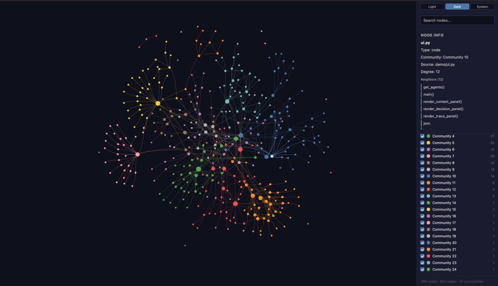

# Graph Propagate

**Graph-guided legacy migration for AI agents.**
Graph Propagate is a fork of [Reversa](https://github.com/sandeco/reversa) that gives its agents a real, offline code graph ([Graphify](https://github.com/Graphify-Labs/graphify)) instead of making them read raw files, and wraps the migration in full-repository security scans, a local dashboard and an MCP server.

<p align="center">
  <br>
  <em>Graphify knowledge graph, grouped by community</em>
</p>

## Links

| What | Link |
|---|---|
| Main repo (`codex-legacy-migrate`) | https://github.com/amany9000/codex-legacy-migrate |
| Repo used for migration, and the migrated result (NanoHTTPD) | https://github.com/amany9000/nanohttpd |
| Migration MCP repo | https://github.com/adarshsaraf1234/migration-mcp |
| Graphify MCP (hosted) | https://migration-mcp-trial-production.up.railway.app/mcp |
| npm package published URL | https://www.npmjs.com/package/graph-propagate/v/1.4.0
 |

---

## Why this fork exists

<p align="center">
  <br>
  <em>Reversa: the framework Graph Propagate builds on (Macedo &amp; da Costa, May 2026)</em>
</p>

Reversa turns a legacy system into executable specifications, but its agents (Scout, Archaeologist, Detective, Architect, Migrate team) work by having an LLM read raw files one module at a time:

- `modules.json.dependencies` is **inferred by the model**, not parsed.
- Large repos overflow context and the Archaeologist stalls.
- Nothing produces a real call graph (`reversa-arquitetura-3d` waits for a `deps.json` nobody generates).
- Nothing checks what a migrated slice actually changed, or whether it introduced security regressions.

This fork adds the missing structure and the missing safety checks. **Without Graphify installed, everything runs exactly as upstream Reversa.**

## What this fork adds

| Capability | What it does |
|---|---|
| **Graph layer** | Offline tree-sitter AST graph (`graph.json`, `GRAPH_REPORT.md`, `graph.html`) with zero LLM calls |
| **`reversa graph` CLI** | Shell interface agents use: `build`, `snapshot`, `summary`, `context`, `deps`, `diff` |
| **`/reversa-graph` skill** | One shared instruction set so Graphify guidance isn't copied into every agent |
| **Graph-aware pipeline** | Scout, Archaeologist, Detective, Architect, Reviewer and the Migrate team query the graph first and fall back to raw reads only when needed |
| **Security audit** | Full-repository Codex Security scans before and after migration, with Graphify-weighted risk |
| **Dashboard** | Local, read-only view of Reversa state and security posture |
| **Migration MCP** | stdio MCP server exposing graph analysis, bounded context and graph diff to any MCP client |

## Architecture

```
Legacy repo
    │
    ▼
graphify-runner.js ── offline extract (no LLM) ──► graphify-out/{graph.json, GRAPH_REPORT.md, graph.html}
    │                                                     │
    │                                   ┌─────────────────┴──────────────────┐
    │                              graph-context.js                    graph-diff.js
    │                          (context · summary · deps)          (diff baseline latest)
    │                                   └─────────────────┬──────────────────┘
    ▼                                                     ▼
 Migration MCP  ◄──────────────────────────────  `reversa graph <cmd>`
 (any MCP client)                                          │
                                                           ▼
        Scout → Archaeologist → Detective → Architect → Writer → Reviewer → Migrate
                                                           │
                                  security-scan --phase pre ... --phase post
                                                           │
                                                      Dashboard
```

---

## 🛡️ Security & Structural Risk Scoring (`Codex Security` × `Graphify`)

Standard static analysis scans files in isolation—it cannot tell you if a vulnerability sits inside a high-centrality **"God Node"** where a single exploit or refactoring bug will cascade across dozens of downstream modules. 

**`graph-propagate`** combines **Codex Security (`$codex-security` / `@openai/codex-security`)** with **Graphify's AST Knowledge Graph (`graphify-out/graph.json`)** to compute a deterministic **0–100 Risk Score**, **Security Posture Grade (`F` to `A+`)**, and **Ranked Pain-Point Leaderboard** both *before* and *after* migration.

### 1. The 4-Pillar Risk Scoring Formula

Every module in the knowledge graph—and the repository as a whole—is scored on a `0–100` scale (`100` = Maximum Legacy Risk, dropping toward `0` as migration waves are verified):

$$\text{Risk Score (0–100)} = 0.45(V_{\text{CodexSec}}) + 0.30(B_{\text{Graphify}}) + 0.15(E_{\text{Inferred}}) + 0.10(D_{\text{Parity}})$$

| Pillar | Weight | Source | What It Measures |
| :--- | :--- | :--- | :--- |
| **1. Vulnerability Exposure ($V_{\text{CodexSec}}$)** | **45%** | **Codex Security Plugin** | CWE / OWASP findings per module (`CRITICAL` = 40 pts, `HIGH` = 25 pts, `MEDIUM` = 14 pts, `LOW` = 6 pts). |
| **2. Structural Blast Radius ($B_{\text{Graphify}}$)** | **30%** | **Graphify `graph.json`** | Node centrality (`inDegree` callers, `outDegree` dependencies, and `isGodNode` status). Vulnerabilities inside a God Node receive a **Compound Pain-Point Multiplier**. |
| **3. Epistemic / Dynamic Risk ($E_{\text{Inferred}}$)** | **15%** | **Graphify Edge Confidence** | Ratio of `INFERRED` and `AMBIGUOUS` edges (e.g., reflection, dynamic dispatch, untyped runtime calls) vs. AST-guaranteed `EXTRACTED` edges. |
| **4. Verification Deficit ($D_{\text{Parity}}$)** | **10%** | **Migration & Parity State** | Starts at `100` for unmigrated/untested legacy modules and drops to `0` once migrated and verified clean by post-migration security & parity checks. |

---

### 2. Multi-Mode Security Execution (Methods A, B & C)

The security and risk engine works seamlessly across three execution modes:

* **Method C — In-Session Codex Skill (`/plugins install codex-security`):**
  During skill-based migration (`/reversa-migrate` / `$reversa-security`), the agent invokes the Codex Security skill directly inside the session, writes normalized CWE findings to `.reversa/security-pre.json` (legacy baseline) and `.reversa/security-post.json` (migrated target), and triggers `src/security/risk-scorer.js`.
* **Method A — Programmatic SDK (`@openai/codex-security`):**
  When triggered from Node.js or the Live Control Tower UI, `src/security/codex-security-runner.js` dynamically invokes the `@openai/codex-security` SDK.
* **Method B — CLI & Deterministic CWE AST Fallback:**
  Supports `npx @openai/codex-security scan` subprocess execution plus a built-in static CWE pattern scanner (`CWE-89` Injection, `CWE-798` Hardcoded Secrets, `CWE-120` Buffer/Memory hazards, `CWE-362` Race Conditions, `CWE-470` Unsafe Dynamic Dispatch, `CWE-327` Weak Crypto) so offline demos and CI pipelines never fail.

---

### 3. Live Control Tower Dashboard (`http://localhost:4400`)

Launch the interactive **Migration & Security Control Tower** to visualize your codebase's dependency graph, blast radius, and CWE pain points in real time:

```bash
# Run a standalone security + Graphify blast-radius audit in the terminal
npm run security:scan

# Launch the Live Control Tower Dashboard on http://localhost:4400
npm run dashboard


## Installation

Prerequisites: Node.js 21+ (Node.js 22.13+ if you run the security scans), Python 3.10+ with [`uv`](https://docs.astral.sh/uv/) (Graphify).

```bash
# 1. Install the Graphify CLI (Reversa never installs Python packages itself)
uv tool install graphifyy

# 2. Clone this fork
git clone https://github.com/amany9000/codex-legacy-migrate.git

# 3. In the root of the legacy project
node /path/to/codex-legacy-migrate/bin/reversa.js install
```

<p align="center">
  <br>
  <em>The installer detects your AI engines and sets up the agents</em>
</p>

The installer detects the AI engines in your environment (Claude Code, Codex, Cursor, etc.), copies the Reversa agents to `.agents/skills/` (and `.claude/skills/` for Claude Code), creates the engine entry file and the `.reversa/` structure, and, if you enable Graphify integration, runs `graphify install` for each detected engine and records the choice in `.reversa/state.json`.

Reversa never deletes or modifies existing files in your project. Agents write only to `.reversa/` and the output folder (`_reversa_sdd/` by default).

## Quick start

Open the project in your AI agent and run:

```
/reversa            # engines without slash commands (e.g. Codex): reversa
```

When Graphify is enabled, the orchestrator builds the graph before the Scout runs and shows graph communities next to the folder-based module list at the existing blocking checkpoint.

| Goal | Command |
|---|---|
| Analyze a legacy system and produce specs | `/reversa` |
| Same, end to end without intermediate stops | `/reversa-autonomous` |
| Build, update or inspect the graph | `/reversa-graph build \| update \| status` |
| Rebuild the legacy on a modern stack | `/reversa-migrate` |
| Evolve the system one feature at a time | `/reversa-forward` |
| Render specs as an HTML mini-site | `/reversa-docs` |
| **Codex Security × Graphify Risk Scorer** — Joins `$codex-security` CWE findings with `graphify-out/graph.json` blast radius to output a `0–100` Risk Score, Security Grade (`F` to `A+`), and Pain-Point Register. |`/reversa-security` (or `npm run security:scan`) |
| **Live Control Tower (`http://localhost:4400`)** — Interactive dependency graph with a **Security Risk Heatmap toggle**, 4-pillar node inspector, and live Pre/Post-migration risk delta. |  `npm run dashboard` (`reversa dashboard`) |

The full agent catalog (Ideation, Forward, Pricing, Front-end, Bug, Code Quality and Documentation teams) is inherited unchanged from [Reversa](https://github.com/sandeco/reversa).

## Graph CLI

Agents can only run shell commands, so the graph is exposed through `reversa graph`:

| Command | Purpose |
|---|---|
| `reversa graph build` | Analyze the current folder offline and write `graphify-out/` |
| `reversa graph snapshot <name>` | Save a named copy of the graph (e.g. `baseline`, `latest`) |
| `reversa graph summary` | Communities, central nodes, counts |
| `reversa graph context <symbol>` | Callers, callees and impact set for a symbol |
| `reversa graph deps` | Emit the `deps.json` that `reversa-arquitetura-3d` expects |
| `reversa graph diff baseline latest` | Structural changes between two snapshots |

The runner works on any language Graphify supports, does not require a `package.json`, checks that Graphify is installed first and forces offline mode.

## How agents use the graph

| Agent | Use |
|---|---|
| **Scout** | Records a graph summary in `surface.json.knowledge_graph` |
| **Archaeologist** | Scopes each module with `context`; fills real dependencies into `modules.json` with a `source: graph \| inferred` marker |
| **Detective / Architect** | Use callers and impact as evidence for flows, C4 components and `traceability/spec-impact-matrix.md` |
| **Reviewer** | Validates module relationships against exact graph node IDs |
| **Strategist** | Orders migration from impact sets, leaf modules first |
| **Inspector** | Diffs the graph before and after each migrated slice and flags unexpected changes at the human checkpoint |
| **3D view** | Reads `deps.json` from `reversa graph deps` |

Claims are labeled `EXTRACTED` (parsed from code) or `INFERRED`; agents prefer `EXTRACTED` and state which one each claim comes from. Every fallback to raw file reads is logged.

## Security audit

The `reversa-security-audit` skill runs [Codex Security](https://www.npmjs.com/package/@openai/codex-security) against the **full** target repository. Graphify provides focused context for migration but never narrows scan coverage.

```bash
npx @openai/codex-security login          # or configure a supported API key

npx reversa security-scan --target ./legacy-app --phase pre
npx reversa security-scan --target ./legacy-app --phase post --max-cost-usd 5
npx reversa security-scan --target ./legacy-app --phase pre --dry-run   # verify target and phase only
```

- Run `pre` before source changes and `post` after the migrated source is present.
- Findings are compared only when both scans completed with complete coverage. Failed or incomplete scans are never reported as clean.
- Requires Node.js 22.13+ (22.x), 24.x or 26.x and Python 3.10+. There is no heuristic fallback when Codex Security is unavailable.
- Output (scan JSON, scorecard, Markdown report) is stored in `.reversa/security/` with restrictive permissions where supported. Reports can contain sensitive source excerpts.

**Graph-weighted risk** combines vulnerability exposure (45%), Graphify blast radius (30%), graph uncertainty (15%) and verification deficit (10%). If Graphify data is unavailable the security posture is still reported but the composite score is marked unavailable. Findings with no Graphify file match remain visible as unmapped repository findings.

## Dashboard

```bash
npx reversa dashboard --target ./legacy-app
```

Binds to `127.0.0.1:4400`, reads Reversa state without changing it, and can trigger a full-repository security scan. Run it in a separate terminal.

## Migration MCP

A small stdio MCP server for Graphify-based migration analysis, so any MCP client can use the graph without the Reversa CLI. It reuses the bundled Graphify runner and the JavaScript context/diff adapters and does not modify native Graphify artifacts.

Source: https://github.com/adarshsaraf1234/migration-mcp (`src/migration_mcp`)
Hosted endpoint: https://migration-mcp-trial-production.up.railway.app/mcp

To use the hosted server from an MCP client that supports HTTP servers, for example Claude Code:

```bash
claude mcp add --transport http graph-propagate https://migration-mcp-trial-production.up.railway.app/mcp
```

To run it locally over stdio instead, see below.

| Tool | Purpose |
|---|---|
| `analyze_legacy_repo(repository_path, timeout_seconds?)` | Runs the Graphify runner and verifies `graph.json`, `GRAPH_REPORT.md` and `graph.html` |
| `get_migration_context(graph_path, target, max_depth?, max_nodes?, max_edges?, timeout_seconds?)` | Bounded context from an existing native graph |
| `compare_migration_graphs(baseline_graph_path, after_graph_path, timeout_seconds?)` | Structural diff between two graphs |

Requirements: Python 3.11+, `uv`, Node.js, and the Graphify CLI (needed only for `analyze_legacy_repo`; context and comparison work on existing snapshots).

```bash
uv sync --project src/migration_mcp
uv run --project src/migration_mcp python src/migration_mcp/server.py
```

For nonstandard executable locations set `MIGRATION_MCP_NODE` and `MIGRATION_MCP_GRAPHIFY` in the MCP client's environment.

Tests:

```bash
uv run --project src/migration_mcp python -m unittest discover -s src/migration_mcp/tests -v
```

> Structural graph differences do not establish behavioral equivalence. Run and review the relevant tests separately.

See the [Graphify contract](https://github.com/adarshsaraf1234/migration-mcp/blob/feature/migration-mcp/docs/graphify-contract.md) for verified graph behavior.

## Results on NanoHTTPD

Per-agent telemetry from a real run on [NanoHTTPD](https://github.com/amany9000/nanohttpd), logged to `.reversa/context/graph-usage.jsonl`:

| Agent / unit | Graph queries | Raw reads | Raw lines | Fallbacks |
|---|---|---|---|---|
| Scout | 5 | 3 | 82 | 0 |
| Archaeologist: core | 2 | 11 | 891 | 0 |
| Archaeologist: websocket | 2 | 6 | 650 | 0 |
| Archaeologist: webserver | 1 | 5 | 425 | 0 |
| Archaeologist: nanolets | 1 | 3 | 370 | 0 |
| Archaeologist: fileupload | 1 | 1 | 120 | 0 |
| Archaeologist: markdown-plugin | 1 | 2 | 150 | 0 |
| Archaeologist: samples | 1 | 3 | 280 | 0 |
| Archaeologist: relocation | 0 | 6 | 95 | 1 |
| Detective | 5 | 1 | 7 | 0 |
| Architect | 5 | 0 | 0 | 0 |
| Reviewer | 15 | 0 | 0 | 0 |
| **Total** | **39** | **41** | **3,070** | **1** |

- The graph locates entry points and scopes each module; agents then read only focused code (contracts, handshake, routing) instead of walking the tree.
- Detective, Architect and Reviewer worked almost entirely from graph queries (one raw read of 7 lines across all three).
- The single fallback was `relocation`: the AST graph does not model Maven relocation POMs, so the agent inspected the POM directly and logged it.

## Migration Summary

The NanoHTTPD migration, run through Graph Propagate:

| Area | Summary |
| --- | --- |
| Code migration | 19 migration tasks completed across the existing modules, preserving the module layout and class based library design. |
| Java baseline | Java 17 selected as the target. |
| Build configuration | Maven and Gradle build configuration updated to support the migration. |
| Dependencies | Maven plugin and library dependencies were reviewed and updated; Gradle dependencies/build setup were aligned. |
| Verification | `mvn compile` succeeded. The README's second command needs the core snapshot installed or built in the reactor first. |

## Demo flow

1. `security-scan --phase pre` on the legacy repo.
2. `reversa graph build`, `reversa graph snapshot baseline`, `reversa graph summary` (offline, no LLM calls).
3. Run `/reversa` with the dashboard open in a second terminal.
4. Show the telemetry: agents answering from graph queries with few raw reads.
5. After a migrated slice: `reversa graph snapshot latest`, `reversa graph diff baseline latest`.
6. `security-scan --phase post` and compare with the pre scan.
7. Remove `graphify` from `PATH` and show the pipeline still completes with a single "graph unavailable" note.

## What to commit

Commit `.agents/`, `AGENTS.md`, `_reversa_sdd/`, `_reversa_forward/` and `.reversa/` so teammates can resume a run. Add these lines to the target repo's `.gitignore`:

```
# Reversa
.reversa/config.user.toml
.reversa/graphify-out/
.reversa/context/graph-usage.jsonl
```

The graph is rebuilt offline in seconds and changes on every rebuild. Only one person should run an analysis at a time to avoid merge conflicts in `.reversa/state.json`.

## Testing

Testing is currently manual: install into a small sample legacy project, run each `reversa graph` command, run `/reversa` once with Graphify installed and once with it removed, then run `reversa update` and confirm the entry file is not reported as modified. The Migration MCP has its own unit tests (see above).

## Safety

- Graph extraction is offline; source code is not sent to an LLM for it.
- Agents write only to `.reversa/` and the output folders unless an explicit, approved gate says otherwise.
- Security scans run before and after migration; incomplete scans are never reported as clean.
- Unexpected graph changes after a migrated slice go to a human checkpoint.
- Back up your project and commit to Git before starting. AI agents can make mistakes.

## Credits and licenses

| Component | Author | License |
|---|---|---|
| [Reversa](https://github.com/sandeco/reversa) | sandeco | MIT |
| [Graphify](https://github.com/Graphify-Labs/graphify) | Graphify Labs | Apache-2.0 / MIT (external CLI, not bundled) |
| [Impeccable](https://github.com/pbakaus/impeccable) | Paul Bakaus | Apache-2.0 (Front-end Team, inherited from Reversa) |
| [NanoHTTPD](https://github.com/NanoHttpd/nanohttpd) | NanoHTTPD contributors | BSD-3-Clause (demo target) |

This fork is released under the same MIT license as Reversa.
